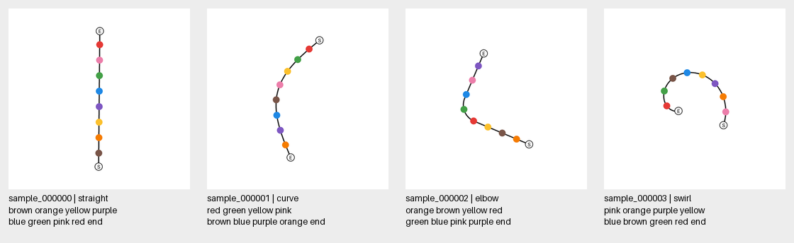

# MLLM Line Tracing

MLLM(Multimodal Large Language Model)의 시각적 연속성 인지 능력을 line tracing 문제를 통해 분석하는 연구 저장소입니다.

## 연구 범위

- 분석 대상: MLLM의 시각적 연속성 인지 능력
- 연구 과제: line tracing
- 첫 번째 작업: 연구에 사용할 합성 데이터셋 제작

## 작업 흐름

1. 작업마다 저장소에 전용 폴더 하나를 만들고 기획·노트북·작은 결과 요약을 함께 관리합니다.
2. Codex가 완성된 Colab 노트북을 먼저 작성·검증해 GitHub에 게시합니다.
3. 사용자가 게시된 노트북을 내려받거나 Colab에서 열어 셀을 순서대로 직접 실행합니다. 명시적인 요청이 없으면 Codex가 Colab 수집·분석을 자동 실행하지 않습니다.
4. 노트북에는 순서가 보이는 실행 단계, 명시적인 Drive 경로, 진행·성공·검증 출력과 중단 후 재개 기능을 포함합니다.
5. 모든 원시 데이터는 사용자의 Google Drive에 보관하고, GitHub에는 코드·설정·manifest·작은 요약과 분석 결과를 기록합니다. Colab 임시 결과는 Drive 보관을 검증한 뒤에만 보관 완료로 처리합니다.

상세 작업 규칙은 [AGENTS.md](AGENTS.md)에 있습니다.

## 현재 분석 작업

[Exp002: patch PCA·단어별 attention·선 연속성](experiments/exp002_patch_analysis)은 run002의 실패 나선·성공 나선·성공 직선 세 사례를 분석합니다. [노트북을 내려받아](https://github.com/seungjoolee24/mllm-line-tracing/raw/refs/heads/main/experiments/exp002_patch_analysis/patch_analysis.ipynb) Colab에서 셀별로 실행하면 결과가 사용자의 Google Drive에 저장됩니다. PCA는400×2560, 연속성 비교는 merge 전1600×1024 표현을 사용합니다.

## 단일 경로 생성기 v0

S에서 E까지 **선 하나를 따라 만나는 색 원의 순서를 출력**하는 기초 과제입니다. 과제 자체의 신규성보다 MLLM 내부 표현을 분석하기 위한 정확한 기하·오브젝트 주석을 우선합니다.

- 기본 이미지: 640×640, 흰 배경, 검은 선 하나, 고유 색 원 8개.
- 형태: `straight`, `curve`, `elbow`, `swirl`. 기본값은 완만한 `curve`입니다.
- 방해선·교차·분기·가림은 없고, 회전과 추적 방향은 seed에 따라 바뀝니다.
- 정답 예: `red blue green orange pink brown yellow purple end`.

Python 3.9 이상과 CPU만 필요합니다. GPU나 모델 다운로드가 필요하지 않습니다.

```bash
python -m pip install -r requirements.txt
python -m line_tracing --output data/easy_v0 --count 100 --family curve --seed 42 --preview
python -m line_tracing.audit data/easy_v0
```

여러 형태의 샘플을 확인하려면 다음을 실행합니다. 출력 경로가 이미 존재하면 덮어쓰지 않고 종료합니다.

```bash
python -m line_tracing --output data/mixed_v0 --count 16 --family mixed --seed 42 --preview
python -m unittest discover -s tests -v
```

선 길이와 점 간격은 별도로 지정할 수 있습니다. `--object-spacing`은 **선을 따라 잰 점 중심 사이 거리(px)**이며, `--position-jitter 0`이면 정확히 그 간격으로 배치합니다. 남는 길이는 양 끝에 동일하게 둡니다. 점·시작/끝 표지가 겹치거나 요청한 간격이 들어가지 않으면 실패합니다.

```bash
python -m line_tracing --output data/spaced_v0 --count 100 --family curve --path-length 480 --num-objects 8 --object-spacing 56 --seed 42
```

불규칙성을 주려면 각 점을 경로를 따라 움직이는 `--position-jitter`를 지정합니다.

```bash
python -m line_tracing --output data/irregular_v0 --count 100 --family curve --path-length 480 --object-spacing 56 --position-jitter 8 --seed 42
```

`--position-jitter 8`은 각 원을 기본 호 길이 위치에서 최대 ±8px 움직입니다. 양끝의 빈 경로는 기본 점 간격의 1.25배 이내로 제한하며, jitter를 포함해 들어가지 않는 설정은 오류로 알려줍니다.

Colab에서는 저장소를 clone하고 `%cd mllm-line-tracing`한 뒤 같은 명령을 `!python ...`으로 실행할 수 있습니다. 실행 예는 [Colab notebook](notebooks/generate_single_line.ipynb)에 있습니다.

[Colab에서 열기](https://colab.research.google.com/github/seungjoolee24/mllm-line-tracing/blob/main/notebooks/generate_single_line.ipynb)

바로 확인할 수 있는 작은 데이터셋은 [등간격 4종](examples/easy_v0)과 [불규칙 간격 4종](examples/irregular_v0)입니다. 검증 범위는 [검증 기록](docs/validation_v0.md)에 있습니다.



## 저장되는 데이터

```text
easy_v0/
  manifest.json
  annotations.jsonl
  images/sample_000000.png
  masks/sample_000000_path.png
  masks/sample_000000_objects.png
  preview.png
```

`images/`의 PNG와 각 record의 `prompt`만 모델 입력입니다. 정답·주석·마스크·정답이 적힌 `preview.png`는 분석 및 QA용입니다.

각 JSONL record에는 다음 정보가 들어 있습니다.

- 중심선 좌표와 누적 호 길이, 실제 경로 길이, S/E 위치, 회전·방향.
- 원별 색, 중심 좌표와 정규화 좌표, bbox, 반지름, 경로 위 순서, 접선, 앞뒤 오브젝트 ID.
- `answer_colors`, `answer`, 생성 config와 seed, PNG 파일 경로와 SHA256.
- 이진 경로 마스크와 오브젝트별 인스턴스 마스크. 마스크 값은 `objects[].mask_value`로 연결됩니다.

모델별 patch index는 입력 전처리 이후 계산해야 하므로 고정해 저장하지 않습니다. 주석 규약, 생성 제약과 원전과의 차이는 [생성기 명세](docs/generator_v0.md)에 정리했습니다.

## 기획과 원전

[Codex Pages 설계](https://chatgpt.com/space/page_2601957ef5a88191a659fc67d27759e4)에서 기획을 관리하고 구현을 이 저장소에 반영합니다. Page는 계정별 접근 권한이 적용됩니다.

[VLMs Trace Without Tracking](https://arxiv.org/html/2605.15672v2)의 Circuit Connections·Swirl을 참고한 단일선 기초 조건입니다. 선 두께·원 크기·경로 형태는 자체 명세이며, 원 논문의 정확한 재현으로 표기하지 않습니다.

## 활성값 수집 실험

[Qwen3 VL 4B T4 실험](experiments/exp001_qwen3vl4b_trace10)은 이미지·질문·생성 토큰의 전 층 표현과 attention을 수집합니다. 정식 run002에서 고정한 10문제의 수집을 완료했으며, 결과 메타데이터는 [실험 결과 폴더](experiments/exp001_qwen3vl4b_trace10/results/run002)에 있습니다. 이후 작업에는 위의 사용자 직접 실행 흐름을 적용합니다.

[활성값 수집 노트북을 Colab에서 열기](https://colab.research.google.com/github/seungjoolee24/mllm-line-tracing/blob/main/experiments/exp001_qwen3vl4b_trace10/activation_pilot.ipynb)
