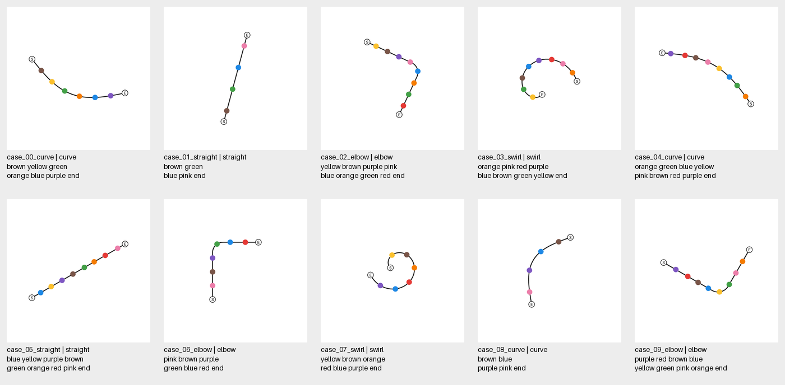

# Qwen3 VL 4B 단일선 추적 활성값 수집

이 실험은 입력 이미지·질문·생성 토큰의 내부 표현과 층별 attention을 기록한다. 문제 풀은 10개로 고정하지만 **첫 실행에서는 1개만 수집하고 용량과 VRAM을 확인한 뒤 중지**한다.

[Colab에서 노트북 열기](https://colab.research.google.com/github/seungjoolee24/mllm-line-tracing/blob/main/experiments/exp001_qwen3vl4b_trace10/activation_pilot.ipynb)

[Pages 실험 기획](https://chatgpt.com/space/page_e1d9472c14d481918accb471b01e85be)

## 실행 조건

- 모델: `Qwen/Qwen3-VL-4B-Instruct`, revision은 [config.json](config.json)에 고정.
- Transformers 4.57.1, Torch 2.8.0, T4, FP16, eager attention, batch 1.
- greedy 자유 생성, 최대 64 token. 원 checkpoint 설정과 실제 생성 설정을 각각 저장.
- 같은 답을 causal replay하여 수집하며 정답을 강제로 입력하는 조건과 구분.
- 첫 답 token의 predictor는 마지막 prompt 위치. 실제 생성과 replay의 token별 argmax 정렬을 검증.

## 고정 문제 풀

직선 2개, 완만한 곡선 3개, 한 번 꺾이는 선 3개, 느슨한 나선 2개다. 4·6·8개 색 원, 여러 회전·추적 방향, 등간격·불규칙 간격을 포함한다. [prepare_cases.py](prepare_cases.py)의 명시적 recipe와 seed로 재현된다. 첫 문제는 완만한 곡선에 원 6개인 `case_00_curve`다.



## 수집 규격

| 지점 | 보존하는 값 |
| --- | --- |
| ViT 24 block | 각 block의 입력·출력 전체 token hidden state |
| 최종 merger 및 DeepStack 3개 | 입력·출력 특징 |
| Decoder 36 layer | 전체 시퀀스의 입력·DeepStack 주입 전 출력 |
| Decoder 최종 norm | 이미지·질문·생성 위치를 포함한 출력 |
| Decoder attention | 모든 head의 질문·답 예측·생성 위치 행 → 이미지 위치 열 |
| 생성과 replay | token IDs, 단계별 raw logits, 정렬 검사와 정답 비교 |

Hidden state는 norm 같은 요약값으로 대체하지 않고 원본 벡터를 저장한다. Attention의 full-sequence softmax 값도 이미지 영역 내부로 재정규화하지 않는다. Decoder block 입력은 이전 DeepStack 주입 이후이며 block 출력은 같은 인덱스 DeepStack 주입 이전이다. Tensor snapshot은 반드시 복사해 이후 in-place 변경과 분리한다.

질문 토큰, 생성 토큰, 답 예측 위치는 `meta.json`의 layout으로 구분한다. 원시 ViT patch와 decoder visual token은 서로 다른 시퀀스다. `token_geometry.json`은 2×2 block-major ViT 순서, merged token 순서, 픽셀 bbox와 오브젝트 mask의 겹침을 기록한다.

## 결과 폴더

```text
results/run001/
  run_config.json
  environment.json
  model_config.json
  generation_config.json
  run_summary.json
  size_report.json
  samples/case_00_curve/
    meta.json
    token_geometry.json
    tensors/vision/...
    tensors/merger/...
    tensors/decoder/...
    tensors/generation/...
    tensors/replay/...
```

각 tensor의 shape·dtype·SHA256·파일 크기를 색인한다. 활성값은 FP16이고 logits·일부 요약은 FP32이며 token ID는 정수다. layer별로 CPU로 옮겨 즉시 저장하므로 전체 attention 행렬을 GPU에 계속 쌓지 않는다.

Colab 런타임 파일은 임시이므로 첫 수집 후 notebook에서 결과 ZIP을 다운로드한다. 재개할 때는 같은 `results/run001`을 유지하거나 ZIP을 동일 위치에 복원한다. 완료 문제는 설정 hash와 각 tensor의 hash·shape·dtype를 검사한 뒤 건너뛴다.

## 재개

노트북의 `CONTINUE_REMAINING=False`는 그대로 둔다. 첫 문제의 실제 용량을 검토한 뒤 True로 바꾸면 같은 노트북에서 나머지 9개를 이어서 수집한다. 코드·데이터·모델 revision·생성 설정이 달라지면 이전 결과와 섞지 않는다.

## 검증

`test_collect.py`는 사전학습 가중치를 다운로드하지 않고 작은 임의 초기화 Qwen3VL 모델을 사용한다. Hook 전후 logits 불변성, attention 행·열 추출, DeepStack 전후 snapshot, 생성 predictor 위치, CPU 파일 저장과 hook 정리를 검사한다. 실제 4B T4 실행 결과는 `results`의 실행 기록으로 별도 확인한다.
